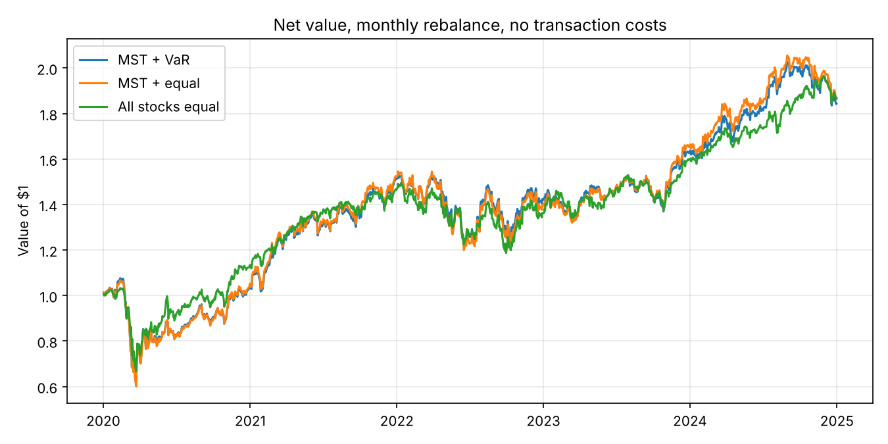
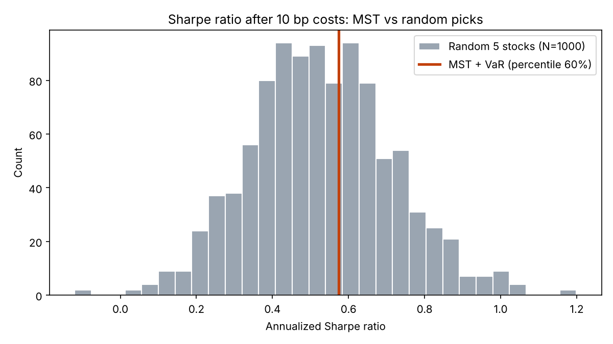

# Dependency-Network Stock Selection: A Simplified Replication

A simplified replication of the network-based portfolio in
Lin, Liu & Rojas (2025), *Dependency Network-Based Portfolio Design with Forecasting and VaR Constraints* ([arXiv:2507.20039](https://arxiv.org/abs/2507.20039)),
with two additions: **transaction costs** and a **random-selection benchmark**.

Author: Huacheng Chen (UCLA, Mathematics of Computation)

---

## Summary

Each month, I build a dependency network of S&P 100 stocks from pairwise VAR(1) models and forecast error variance decomposition (FEVD), keep its minimum spanning tree (MST), buy the 5 stocks with the highest degree, and weight them by inverse Value at Risk.

Over 2020–2024 (monthly rebalancing):

- The MST strategy earned a **Sharpe ratio of 0.62** before costs. Equal-weighting all 98 stocks earned **0.71**.
- Against **1,000 random 5-stock portfolios** built with the same rules, the MST picks rank at the **50th percentile** before costs and the **60th percentile** after 10 bp costs.
- In this setting, **network-based selection is not distinguishable from random selection**. Its one practical advantage is **lower turnover** (102% vs 190% per month), which helps after costs.

---

## Method

| Step | What I do | Paper section |
|---|---|---|
| 1. Network | For every pair of stocks, fit a bivariate VAR(1) on the last 120 trading days. Compute the 10-day generalized FEVD θ. | 3.1, 3.2 |
| 2. Cost | Edge cost C = 1 − θ. Make it symmetric with C<sub>ij</sub> = min(C<sub>i→j</sub>, C<sub>j→i</sub>). | 3.3, eq. (7)–(8) |
| 3. MST | Minimum spanning tree of the 98-node cost matrix (`scipy`). | 3.4 |
| 4. Select | Pick the 5 stocks with the highest degree in the MST. | 4.2 |
| 5. Weight | 1-day historical VaR at 95% over the same 120 days. Weight ∝ 1/VaR (VaR clipped at 0.001). | 4.3 |
| 6. Trade | Rebalance at the close of the last trading day of each month. Hold until the next rebalance. | — |

**No look-ahead.** On rebalance day *d*, the 120-day window ends on *d* (inclusive). The holding period starts on the trading day **after** *d*.

**FEVD.** I use the generalized FEVD of Diebold & Yilmaz (2012), which the paper cites, and normalize each row to sum to 1. This keeps every θ between 0 and 1, so every edge cost is positive.

### Differences from the paper

| | Paper | This replication |
|---|---|---|
| Universe | ~490 S&P 500 stocks | 98 S&P 100 stocks |
| Rebalancing | Daily | Monthly |
| Test period | 365 trading days (2022–2023) | Jan 2020 – Dec 2024 (60 months) |
| Forecast filters (ARIMA, NNAR, AllAgree) | Yes | No |
| Transaction costs | Discussed, not modeled | 0, 10, 30 bp per unit of turnover |
| Random-selection benchmark | No | 1,000 random portfolios |

So the closest row in the paper's Table 1 is **MST + VaR**. Because the settings differ, the numbers are not directly comparable.

---

## Data

- **Universe:** S&P 100 members as of late 2019 (Wikipedia, revision of 2019-12-05; table dated 2019-11-21). Using a fixed list from *before* the test period avoids picking today's winners.
- **Prices:** Yahoo Finance via `yfinance`, daily adjusted close, 2019-07-01 to 2024-12-31. The first ~6 months are only used as the first 120-day window.
- **Ticker changes (kept):** FB → META, BRK.B → BRK-B, UTX → RTX, BK → BNY.
- **Dropped (no data available):** AGN (acquired 2020), RTN (merged 2020), WBA (taken private 2025).
- **Final sample:** 98 stocks × 1,385 daily returns, no missing values.

---

## Results

### 1. Backtest, no transaction costs

| Strategy | Total return | Annual return | Annual vol | Sharpe | Max drawdown |
|---|---|---|---|---|---|
| MST + VaR | 84.3% | 13.0% | 24.4% | 0.62 | −43.6% |
| MST + equal weight | 86.9% | 13.3% | 25.1% | 0.63 | −43.8% |
| All 98 stocks, equal weight | 86.6% | 13.3% | 20.8% | 0.71 | −35.4% |



### 2. Transaction costs

| MST + VaR | Total return | Annual return | Annual vol | Sharpe | Max drawdown |
|---|---|---|---|---|---|
| 0 bp | 84.3% | 13.0% | 24.4% | 0.62 | −43.6% |
| 10 bp | 73.4% | 11.7% | 24.4% | 0.57 | −43.6% |
| 30 bp | 53.4% | 9.0% | 24.4% | 0.47 | −43.7% |

Average monthly turnover: **102%** (MST) vs **190%** (random).

### 3. Random-selection benchmark (1,000 portfolios)

Same universe, same rebalance dates, same 1/VaR weights, same costs. The only difference: the 5 stocks are drawn at random each month.

| | MST Sharpe | Random median | MST percentile |
|---|---|---|---|
| No cost | 0.624 | 0.622 | 50.5% |
| 10 bp cost | 0.574 | 0.519 | 59.9% |



---

## Findings

1. **Selection.** Before costs, the MST picks sit at the 50th percentile of random picks. They are not better than chance.
2. **Turnover.** After costs, the MST rises to the 60th percentile. This comes from lower turnover (MST keeps 2–3 of its 5 stocks each month; random picks replace almost all of them), not from better picks. It is still within the range of luck.
3. **VaR weighting.** The weights do differ (about 16%–29% in the first month), and VaR weighting slightly lowers volatility. But the 5 selected stocks move closely together, so shifting money among them barely changes the portfolio (Sharpe 0.62 vs 0.63).
4. **What the network captures.** For AAPL–MSFT in the first window, the lagged VAR coefficients are small (|a| ≤ 0.15), but θ is still about 0.26. Almost all of it comes from the **same-day correlation** of the VAR residuals (0.58), not from yesterday-to-today effects (`scripts/pair_example.py`):

   | AAPL–MSFT, 2019-07-02 to 2019-12-19 | θ (MSFT → AAPL) | θ (AAPL → MSFT) |
   |---|---|---|
   | Full (h = 10) | 0.260 | 0.253 |
   | Same-day term only (h = 1) | 0.254 | 0.254 |
   | Residual correlation removed | 0.014 | 0.001 |

   So the network is close to a correlation network, and high-degree stocks behave like a concentrated "mini market": higher volatility and deeper drawdowns than the equal-weight universe. (The paper notes a similar idea: the method acts like "a compressed version of the S&P 500.")

5. **Noise.** With 5 years of data, the standard error of a Sharpe ratio is roughly √(1/5) ≈ 0.45. All Sharpe differences above are well inside this range. The random portfolios alone range from about −0.1 to 1.2.

---

## Limitations

- **Survivorship bias.** The 2019 list removes "future winners" bias, but Yahoo Finance no longer has data for some delisted firms (e.g. WBA). The remaining sample leans toward firms that survived.
- **One sample period.** 2020–2024 is a single, mostly rising market with one sharp crash.
- **Simple cost model.** A flat cost per unit of turnover, paid on the first day of each month. No market impact.
- **Risk-free rate set to 0** when computing Sharpe ratios, as in the paper (Section 4.4).
- **Pairwise VAR only.** Each VAR has two stocks, as in the paper. It ignores effects from other stocks.

## Possible extensions

- Report alpha and beta against the market.
- Other centrality measures (betweenness, eigenvector) and other values of k.
- The same pipeline on China A-shares.

---

## Project structure

```
├── data/
│   ├── sp100_20191231.csv     # universe: S&P 100 as of late 2019
│   └── returns.csv            # daily returns, 98 stocks x 1,385 days
├── src/netport/
│   ├── config.py              # window, horizon, k, VaR level, paths
│   ├── data.py                # universe, ticker renames, download, returns
│   ├── fevd.py                # bivariate VAR(1), generalized FEVD
│   ├── network.py             # cost matrix, MST, degree, top-k
│   ├── portfolio.py           # 1/VaR weights, buy-and-hold returns, turnover
│   ├── backtest.py            # rebalance dates, strategy loop, costs, statistics
│   ├── random_test.py         # random-selection benchmark
│   └── plots.py
├── scripts/
│   ├── download_data.py       # -> data/returns.csv
│   ├── run_backtest.py        # -> results/*.csv, results/figures/*.png
│   └── pair_example.py        # AAPL-MSFT: where FEVD dependence comes from
├── tests/test_core.py         # unit tests (pytest)
└── results/                   # outputs used in this README
```

## How to run

```bash
pip install -r requirements.txt
python scripts/download_data.py     # optional: data/returns.csv is included
python scripts/run_backtest.py      # about 6 minutes (2 for selection, 4 for 1,000 random runs)
python scripts/pair_example.py      # the AAPL-MSFT example (seconds)
pytest                              # 17 unit tests
```

`run_backtest.py` caches the monthly selections in `results/selections.csv`. Use `--recompute` to rebuild them and `--n-random 100` for a quick run. The random benchmark uses a fixed seed (2026), so results are reproducible.

## References

- Lin, Z., Liu, H., & Rojas, R. R. (2025). Dependency Network-Based Portfolio Design with Forecasting and VaR Constraints. arXiv:2507.20039.
- Diebold, F. X., & Yilmaz, K. (2012). Better to give than to receive: Predictive directional measurement of volatility spillovers. *International Journal of Forecasting*, 28(1), 57–66.
- Mantegna, R. N. (1999). Hierarchical structure in financial markets. *The European Physical Journal B*, 11(1), 193–197.
